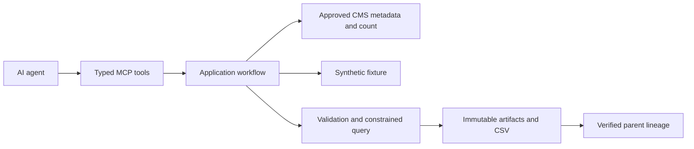

# cms-data-mcp

A local MCP server that lets an AI agent discover a curated CMS source, retrieve
an approved aggregate, validate it, query the saved result, export CSV, and inspect
its provenance.

**The first release works end to end.** It includes nine tools, an offline
synthetic example, and an explicitly enabled live CMS workflow. The live view is
fixed to California records with primary specialty `CARDIOVASCULAR DISEASE
(CARDIOLOGY)`. It counts enrollment/location records, **not distinct clinicians**.
No individual clinician rows, names, NPIs, or addresses are retrieved.

## Try the demo

[**Open the offline replay**](https://bowierliu.github.io/cms-data-mcp/) ·
[Recorded MCP output](docs/replay.json) · [Source and scope](docs/mcp-tools.md)

Explore the five-record fictional California cardiology aggregate, its validation
checks, CSV output and source lineage. GitHub Pages serves static files. You can
also open `docs/index.html` directly from a checkout, including without internet
access. This replay was captured by a real SDK/stdio workflow. It does not run a
model or ask for a key.

## Run the live companion

The companion lets a model choose the next MCP tool and explain its evidence.
Choose a fixed question about validation or source lineage. The app asks OpenAI
to select a tool, materializes the packaged synthetic count, then calls the
selected tool through the official MCP SDK. A second model call reads the actual
tool results. The browser shows the generated explanation separately from the
tool trace so a reviewer can inspect both.

1. Clone this repository (or download and extract its ZIP). Install
   [uv](https://docs.astral.sh/uv/) if needed.
2. Follow the [one-time key and budget setup](docs/LIVE_BUDGET.md). The three
   portfolio companions share a local spending ledger. On macOS use Keychain
   Access to save your key once. Live mode requires the operator to enable it.
3. On macOS double-click **Launch CMS Demo.command**. First launch installs the
   locked Python environment. It opens the local web page and detaches the
   server, so you can close the terminal window. On other supported POSIX
   systems run `uv run --locked python -m cms_mcp.recruiter --launch`.
4. Choose a question under **Ask the model to investigate** and select
   **Run model investigation**. Select **Stop local server** when finished.
   The companion serves only the local computer at `http://127.0.0.1:8767`.

The companion sends a fixed question and selected synthetic aggregate evidence
to OpenAI using the operator's key. There is no browser key field, sign-in,
analytics or free-text patient input. A reviewer can use their own local
credential store and ledger. Each completed investigation makes two text
generations and two MCP tool calls. Budget denials and failures stop the run.
The shared guard also obtains a token count before each generation. Model
explanations require human review.

The **live model** label concerns inference. The companion always uses the
fictional fixture and never retrieves clinician-level data. The separate
`--live` CLI below queries the approved public CMS aggregate without a model.
External MCP clients manage their own model provider, pricing and spending.
The portfolio ledger covers calls made through this companion.

## Quick start

Open the `cms-data-mcp` directory as the project. Requires Python 3.11+ and
[uv](https://docs.astral.sh/uv/). Run from the directory containing this README:

```bash
uv sync --locked --group dev
uv run python scripts/check_mcp.py
```

This launches a real MCP client and server, executes discovery → metadata → schema
→ retrieval → validation → query → CSV export → provenance, then cleans up its
temporary cache. The synthetic result is visibly labeled fictional, with count 5.

For a persistent result:

```bash
uv run python scripts/check_mcp.py --cache-dir data/cache/offline-demo
```

For the approved **live** CMS workflow:

```bash
uv run python scripts/check_mcp.py --live --cache-dir data/cache/live-demo
```

The verified run on 2026-10-04 returned **5,634 matching records**, with a catalog
release date of 2026-09-10. This is an observation at retrieval time, not proof
of an immutable September release. Counts can change. See [verification](docs/release-verification.md).

The earlier application-only demo remains available as `uv run python -m cms_mcp.demo`.

## Test it with an AI agent

The safest first test is offline and uses the packaged fictional fixture. After
running the quick-start commands above, connect the server to any local MCP client
using this stdio launch shape (replace `/absolute/path/cms-data-mcp`):

```json
{
  "command": "/absolute/path/cms-data-mcp/.venv/bin/python",
  "args": [
    "-I", "-m", "cms_mcp.server",
    "--cache-dir", "/absolute/path/cms-data-mcp/data/cache/mcp"
  ]
}
```

Then ask the agent:

> Run the synthetic California cardiology workflow. Discover the dataset, explain
> its row grain, retrieve and validate it, query the result, export CSV, and trace
> the final export back to its source. Clearly distinguish fictional data, record
> counts, and distinct clinicians.

The expected synthetic result is one California cardiology aggregate with a count
of 5, explicitly labeled fictional. An agent should use the MCP tools rather than
inventing results, and should describe the count as enrollment/location records,
not distinct clinicians. See the [agent evaluator quickstart](docs/agent-quickstart.md)
for acceptance prompts, expected behavior, optional live access, and the supervised
evaluation harness.

## Connect your AI client

For a fresh checkout, copy [.cursor/mcp.example.json](.cursor/mcp.example.json) to
`.cursor/mcp.json` after creating the Python environment. The example enables only
the approved live metadata/count endpoints; remove `--enable-live` for offline use.
It uses project-relative variable interpolation and works independently of the
client's working directory. [Client setup](examples/mcp_stdio.md).

The SDK client and configured launch command have been tested. User-run Cursor
Agent testing confirmed all nine tools and the synthetic happy path, but found
an error-output schema mismatch. The fix now passes automated schema and stdio
checks; a real Cursor error retest is still pending. Restart/reconnect the server
to load the new schemas. [Acceptance status and retest](docs/cursor-acceptance.md).

## Why MCP and how it works

An AI agent chooses tools and explains results. Deterministic Python code enforces
source restrictions, validates inputs, performs the operations, and supplies
traceable evidence. The language model is not the source of healthcare facts.



One small Python package contains the domain models, HTTP adapter, file storage,
validation/query logic, application workflow, and stdio transport. The analytical
view has one aggregate row; direct typed filtering is sufficient. DuckDB, Parquet,
and general grouping are deferred until a wider approved view needs them.
[Architecture](docs/architecture.md) · [decision record](docs/adr/002-fixed-aggregate-mvp.md).

## Available tools

| Tool | Purpose |
| --- | --- |
| `search_datasets` | Search one curated CMS source and its fictional fixture |
| `get_dataset_metadata` | Verify current source evidence and return `source_ref` |
| `get_schema` | Explain selected fields from the reviewed dictionary mapping |
| `retrieve_dataset` | Save the fixed aggregate, or reuse an exact cached artifact |
| `materialize_synthetic_count` | Create the fictional count directly |
| `validate_dataset` | Persist explicit contract checks and unchecked assessments |
| `query_dataset` | Project/filter the saved aggregate using allowed fields/values |
| `export_result` | Write the exact saved result as CSV and return its text/hash |
| `get_provenance` | Resolve source, artifact, validation, query, or export lineage |

[Tool parameters and examples](docs/mcp-tools.md). Every meaningful saved result
returns a resolvable `provenance_id`; pass it as `artifact_id` to `get_provenance`.
Search returns curated candidates without claiming fresh release evidence.

Example prompts:

- Find the CMS source containing clinician specialties and explain its row grain.
- Run the synthetic California cardiology count through validation and export CSV.
- Retrieve the approved live count and show the source, time, and transformations.
- Explain why this result cannot answer a San Diego County question.

## Evidence and limits

The source is CMS Provider Data Catalog dataset `mj5m-pzi6`, the Doctors and
Clinicians National Downloadable File. Only its fixed count-only API request is
permitted. The full file is never downloaded. [Source contract](docs/sources/mj5m-pzi6/README.md).

Local SHA-256 hashes identify bytes; they do not establish publisher integrity.
Validation checks the stored count contract and lineage. Publisher checksum,
underlying row quality/nulls/duplicates, and immutable-release binding remain
explicitly unchecked. Original retrieval times survive cache hits; processing
and serving times are separate. [Validation/query contract](docs/analytics.md) ·
[provenance](docs/provenance.md) · [live adapter](docs/live-source.md).

City, ZIP, county, person-level retrieval, arbitrary SQL/URLs/paths, general CMS
catalog search, historical comparison, additional datasets, and warehouse export
are outside this release. Query filters evaluate the saved aggregate; filtering
it to NY yields no rows, not a New York count. CSV export preserves the query's
exact rows and column order.

## Verify and learn

```bash
uv run pytest -m 'not live'
uv run ruff check .
uv run ruff format --check .
uv run mypy src scripts
uv run python scripts/verify_scaffold.py
uv build
uv run python scripts/show_tree.py
```

Default tests are offline. Live requests occur only with the explicit server/demo
flag. Tests cover real files, failure paths, simulated HTTP, SDK sessions, and
stdio processes. [Verification evidence](docs/release-verification.md) and
[agent evaluation](docs/agent-evaluation.md) distinguish those claims.

Seven specialist definitions, five commands, and seven domain skills support
continued development. Use `/teacher <question>` to explain the actual project;
see [agent routing](docs/agent-system.md). [Interview and resume notes](docs/resume.md)
cover only implemented behavior. [PROJECT_STATE.md](PROJECT_STATE.md) is the
current checkpoint.

To publish the reviewed replay, push the intended main commit, run
`sh scripts/publish-pages.sh`, and select **gh-pages / (root)** in GitHub Pages
settings. The script publishes four reviewed assets and a Jekyll bypass marker.

The source repository is public. Public hosting serves the offline replay only.
The live companion runs locally. No open-source license has been selected.
