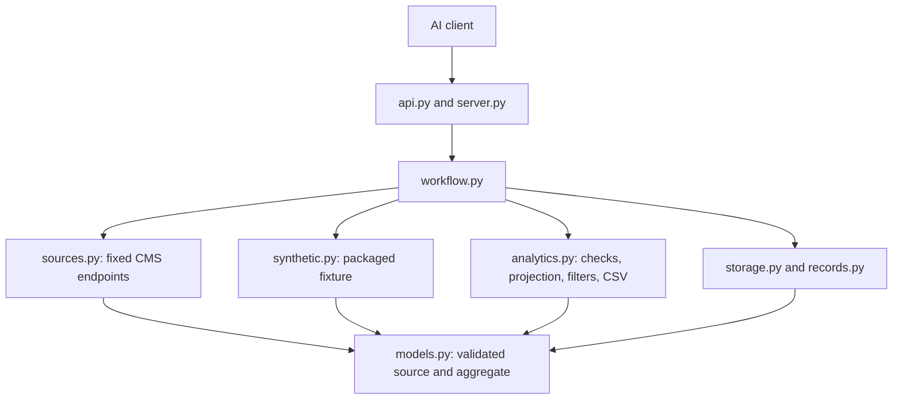

# cms-data-mcp architecture

One Python distribution, `cms-data-mcp`, with import package `cms_mcp`. The first
release implements one complete aggregate workflow, with a synthetic fixture and
one live CMS count adapter. It has no personal-record ingestion or remote server.

| Module | Responsibility |
| --- | --- |
| `models.py` | Strict source, count, normalization and acquisition provenance |
| `synthetic.py` | Packaged fictional fixture shared by CLI and server |
| `sources.py` | Approved HTTP endpoints, source checks, limits, retries, chronology |
| `storage.py` | Immutable bounded files, atomic no-replacement writes, verified reads |
| `records.py` | Canonical typed source/report/result/export documents |
| `analytics.py` | Deterministic reports, finite query interface and CSV rendering |
| `catalog.py` | Curated discovery and dictionary field meanings |
| `workflow.py` | Source selection, artifact operations, parent verification and lineage |
| `api.py` | Tool arguments, output schemas, descriptions and application dispatch |
| `server.py` | Official MCP SDK stdio transport, safe errors and optional call logging |
| `service.py`, `demo.py` | Original application-only synthetic workflow |

Domain operations have no MCP dependency. The HTTP adapter is ordinary Python
with injectable transport and clock. The server runs filesystem/HTTP workflows
in worker threads, keeping the MCP event loop responsive. Cancelled publication
may finish atomically; partial files are not served.

## Storage and provenance

The operator chooses the cache root. Count artifacts remain directly under it,
preserving earlier demo IDs. `records/` contains source references, validation
reports, queries, and export manifests. `exports/` contains CSV bytes. IDs are
local SHA-256 identities; all reads enforce canonical typed content, size limits,
and hash integrity. Filenames come only from validated opaque IDs.

Validation binds an exact artifact/source/snapshot. Query binds the validation
and original artifact. Export binds the saved query and exact CSV bytes. Full
provenance rechecks this chain and keeps source retrieval, processing, and serving
times separate. No mutation turns an old result into a fresh acquisition.

Storage supports trusted local POSIX filesystems. Hostile local writers,
network/Windows filesystem guarantees and power-loss certification are outside
the exercised boundary. Atomic publication does not make multi-file operations a
transaction: a failed export can leave unreferenced complete CSV bytes, never a
successful manifest pointing at partial output. No cleanup scheduler is installed.

## Deliberate limits

The query input is one saved aggregate row. Direct typed projection and filtering
avoid unnecessary database installation. DuckDB is deferred until a wider approved
view justifies it. CSV is sufficient for this release; no Parquet dependency.
[Decision record](adr/002-fixed-aggregate-mvp.md).

Search covers a curated source and its fixture. The schema tool presents a
reviewed dictionary mapping, not a newly downloaded or automatically monitored
full schema. Live count parsing verifies its required fields. County, city, ZIP,
personal rows, arbitrary paths/SQL/URLs, historical comparison and extra datasets
are not supported.

## Dependencies and development assets

Direct runtime dependencies are Pydantic 2, official MCP 2.3, AnyIO 4, and HTTPX2
2.13; exact resolutions are in `uv.lock`. Installed APIs and official documentation
were checked. No pandas, database server, warehouse, HTTP deployment, or distributed
infrastructure is required. Python 3.11 is the exercised runtime.

Seven role definitions, five commands and seven domain skills remain in their
original scaffold locations. `.cursor/skills` and the `.mdc` loader provide native
editor discovery adapters. The project-local MCP launch configuration is ignored;
its portable example is tracked. [Agent routing](agent-system.md).

Unit, filesystem, source-transport, application, and real SDK/stdio tests are
separate from supervised agent evaluations and explicit live observations.
See [release verification](release-verification.md) for evidence and limitations.
